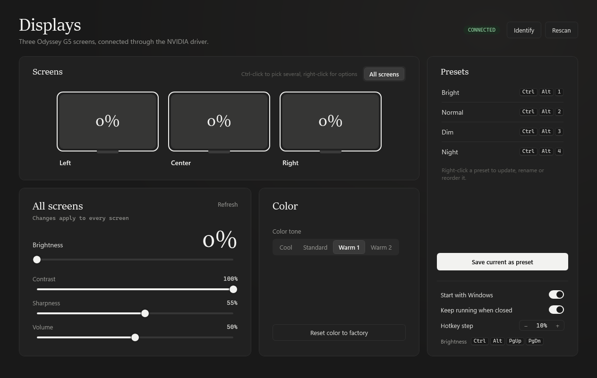
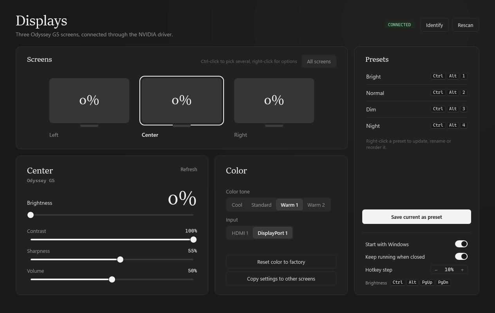

<div align="center">


# Monitor Control

**Change your monitors' brightness, contrast, color and input from Windows, even inside NVIDIA Surround.**

[](https://github.com/bisak/surround-monitor-settings/releases/latest)
[](https://github.com/bisak/surround-monitor-settings/actions)
[](LICENSE)




</div>

## Why

NVIDIA Surround merges several monitors into one big display, so brightness apps like Twinkle Tray or Monitorian only reach one of them. Monitor Control talks to every monitor through the NVIDIA driver's own DDC/CI channel, so each screen stays adjustable. It works without Surround too, and on AMD and Intel graphics through Windows' DDC/CI support.

## Features

|  |  |
|---|---|
| **Every screen, one window** | Adjust all screens together, one alone, or Ctrl-click a few |
| **The settings that matter** | Brightness, contrast, sharpness, volume, color tone, picture mode, input |
| **Presets** | Save the look of every screen and apply it with <kbd>Ctrl</kbd>+<kbd>Alt</kbd>+<kbd>1</kbd> … <kbd>9</kbd> |
| **Hotkeys anywhere** | <kbd>Ctrl</kbd>+<kbd>Alt</kbd>+<kbd>PgUp</kbd> / <kbd>PgDn</kbd> change brightness, with a small on-screen level |
| **Tray app** | Lives in the tray, starts with Windows if you like |
| **Safe by design** | Reads each monitor's own list of supported values and never sends anything else |
| **Fast** | Each monitor has its own I/O lane, so all screens update at once |
| **Portable** | One small exe you can keep anywhere, even on the Desktop. No installer, no admin rights |



## Get it

**Download** `MonitorControl-vX.Y.Z-win-x64.zip` from [Releases](https://github.com/bisak/surround-monitor-settings/releases/latest), unzip anywhere and run `MonitorControl.exe`.

**Or build it yourself in 5 seconds.** Windows already includes the compiler:

```bat
git clone https://github.com/bisak/surround-monitor-settings
cd surround-monitor-settings
build.cmd
```

A locally built exe never shows a SmartScreen warning, because it didn't come from the internet.

> **First run:** if a monitor is missing, turn on **DDC/CI** in that monitor's own on-screen menu, then click **Rescan**.

## Compatibility

| Setup | Status |
|---|---|
| NVIDIA GPU, with or without Surround | ✅ Tested. Every monitor, through NVAPI |
| AMD or Intel GPU, extended desktop | 🟡 Expected to work through Windows DDC/CI, not yet tested |
| Monitors on two different GPUs at once | 🟡 Both paths run together, not yet tested |
| AMD Eyefinity | ⚠️ Probably only one monitor reachable, same limit as Windows itself |
| Laptop built-in screens | ❌ Not supported, they don't use DDC/CI |
| Docks, KVMs, DisplayLink adapters | ⚠️ Often block DDC/CI |

### What to expect from your monitor

Tested on three **Samsung Odyssey G5** (S32CG55) on an RTX 5070 Ti in Surround.

- **Brightness and contrast work on nearly every monitor with DDC/CI.** Sharpness and volume work when the monitor has them.
- **Color tone, picture mode and input are hit and miss.** The app only offers values the monitor says it supports, and monitors often get that list wrong. Expect odd names like *6500K* or *User 1*, missing options, or a choice that does nothing. Monitors with a known quirk get a small profile in [`src/Ddc.cs`](src/Ddc.cs); the Odyssey G5 is the first.
- **Some settings lock in some picture modes.** If a change "doesn't stick", switch the monitor to its standard mode first.
- **No red/green/blue gain sliders.** Equal gains look neutral, and most monitors only apply them in a custom mode, so color tone covers it.

If yours misbehaves, run `MonitorControl.exe /diagnose` and [open a monitor report](https://github.com/bisak/surround-monitor-settings/issues/new?template=monitor_report.yml). That's how profiles get added.

<details>
<summary><b>How it works</b></summary>

- **NVIDIA:** NVAPI's `NvAPI_I2CWrite` / `NvAPI_I2CRead` send MCCS commands straight down each cable, so Windows only seeing one Surround display doesn't matter.
- **Everything else:** Windows' `dxva2` monitor configuration API.
- Each monitor gets its own thread. Slider drags are coalesced, intermediate values aren't read back, and the final value is confirmed once you let go.
- Built on .NET Framework 4.8 and WPF, which ship with Windows 10 and 11, so there's nothing to install.

</details>

<details>
<summary><b>Command line</b></summary>

| | |
|---|---|
| `/tray` | Start hidden in the tray |
| `/diagnose` | Write a report describing every monitor and open it. Reads only. |

Settings live in `%APPDATA%\MonitorControl`, the log and diagnostics in `%LOCALAPPDATA%\MonitorControl`.

</details>

## Contributing

Monitor reports, profiles for more monitors and pull requests are welcome. See [CONTRIBUTING.md](CONTRIBUTING.md).

## License

[MIT](LICENSE)
